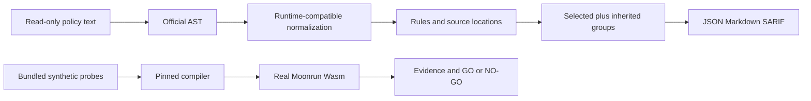

# Architecture

The reusable MoonBit module exposes audit, combine, render and exit_code, plus with_path_context for trusted adapter observations. It takes source text/identity and returns schema-v2 JSON. assessment.mbt separates original configuration findings from contextual projection and keeps malformed/unsupported coverage blocking. The CLI owns explicit I/O, optional metadata-only path inspection and trusted probe orchestration. Parsing and semantic fixes are localized behind this small interface.

The original AST is traversed directly; Ast.to_json is not used because it groups repeated calls. Original locations survive normalization. Offsets count Unicode codepoints; line/column are one-based and end positions exclusive. SARIF uses encoded UTF-8 file URIs.

Selected policy replaces embedded permission values. Embedded syntax/fence/duplicate-declaration errors remain relevant. Supplied inherited groups remain independent ceilings, not an optimistic union. This is an explanatory model, not a theorem prover for arbitrary scope intersections. Ambient inheritance remains explicitly unknown unless supplied.

The EXE preserves literal arguments and invokes a fixed system PowerShell script without expression evaluation. The script checks pinned binaries and Wasm hashes, configures project-local temporary paths, then starts Moonrun. Python is only for developer acceptance/packaging.

The official vendor snapshot is immutable. Only lexer/tokens/moon.pkg in a build copy has rule/dev_build removed to use the unchanged upstream-generated tokens.mbt. Source and executable pins are separate from path-dependent rebuildable core caches.
